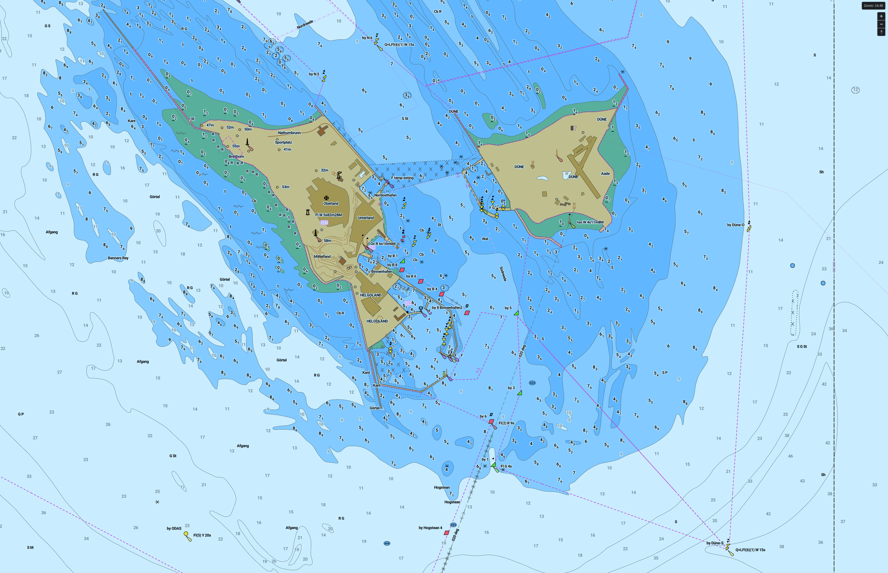
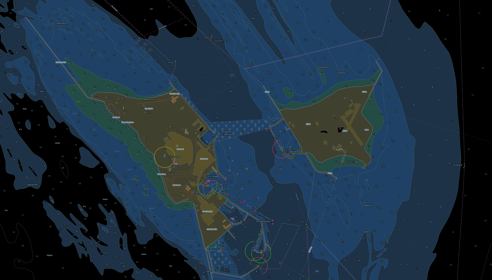

# MapLibre-Nautical




Convert S-57 ENC charts to vector tiles and render them in [MapLibre](https://maplibre.org/) /
[Mapbox](https://www.mapbox.com/) with a chart style ported from [njord](https://github.com/manimaul/njord)
([live demo](https://njord.mxmariner.com)). MapLibre can be included in various frontends like
[Qt](https://github.com/maplibre/maplibre-native-qt), GLFW, iOS, Android, MacOS, Windows and
[more](https://github.com/maplibre/awesome-maplibre).

Everything is static: a chart set becomes one `.mbtiles` plus style JSON, sprite sheets and fonts,
served by any vector tile server (e.g. [tileserver-gl](https://github.com/maptiler/tileserver-gl)).

## How it works

njord's symbology is split in two, and so is this repository (`nautical/`):

1. **Per-feature rules** (`nautical/symbology/layers/*`, one module per S-57 object class): at
   conversion time every feature gets display props written into the tile — the sprite (`SY`),
   area/line colour tokens (`AC`/`LC`), patterns (`AP`/`LP`), sounding digits (`METERS_W`,
   `METERS_T`, …), bearing and light description texts, the light sector icon (`SI`), the topmark
   platform, … This is where buoys, beacons, wrecks, obstructions, depth areas etc. get their
   S-52-ish look.
2. **A MapLibre style** (`nautical/symbology/layerable.py` + each module's `layers()`) whose ~330
   layers read those props. One style per depth unit (metres, feet, fathoms) and theme (day,
   dusk, night) is generated.

The conversion (`nautical/tiles/`) also resolves **chart priority** the way njord's tile server
does: charts are ordered by compilation scale, a chart only appears from the zoom matching its
scale (`DSPM_CSCL`), and wherever a more detailed chart covers it, a coarser chart's features are
cut away from the zoom at which the finer chart becomes visible. Features carry their own
`SCAMIN`-derived minimum zoom. Every chart's `M_COVR` outline goes into the `PLY` layer (drawn at
low zooms, as in the demo).

The port is verified against njord's golden fixtures (`tools/check_njord_port.py`); see
[docs/PORTING.md](docs/PORTING.md) for how the Rust rules map to the Python modules.

## Workflow

Requirements: Docker (the image provides GDAL, tippecanoe, shapely, Pillow and cairosvg).

```shell
git clone <this repo>
docker compose build

# 1. njord's sprite sheets and fonts -> assets/
docker compose run --rm fetch_assets

# 2. S-57 cells -> output/charts.mbtiles (+ charts.json, sectors.json)
#    CHARTS_DIR is searched recursively for *.000 files (updates *.001... are applied)
CHARTS_DIR=./sample_data/ENC_ROOT docker compose run --rm convert_maps

# 3. optional: Natural Earth base map -> output/base.mbtiles (drawn where no chart covers)
docker compose run --rm convert_basemap

# 4. styles, sprite sheets (with the charts' light sector icons), fonts, config -> output/
docker compose run --rm generate_mapstyle
```

Options are passed through `CONVERT_ARGS`, `BASEMAP_ARGS` and `STYLE_ARGS`, e.g.
`CONVERT_ARGS="--max-zoom 16 --workers 4"`; `python3 -m nautical.convert_maps --help` lists them.
The depth colour thresholds (3 / 6 / 9 m) can be changed with `--shallow-depth`, `--safety-depth`
and `--deep-depth` (pass the same values to `convert_maps` and `generate_mapstyle`).

### Output

| File | Content |
|---|---|
| `output/charts.mbtiles` | all charts, one source layer per S-57 object class (+ `PLY`), zooms 0-14 by default (MapLibre overzooms beyond; `--max-zoom 15` quadruples size and time) |
| `output/base.mbtiles` | Natural Earth land/ocean/lakes/... (zooms 0-8) |
| `output/light.json`, `dusk.json`, `dark.json` | styles in metres; `*-feet.json`, `*-fathoms.json` the other units |
| `output/sprites/`, `output/fonts/` | njord's sprite sheets + rendered light sectors, Roboto glyphs |
| `output/config.json` | tileserver-gl configuration |
| `output/charts.json` | the converted charts with scale, display zoom and bounds |

### Light sector icons

Sector lights are drawn with a 200×200 px arc icon per light (bearings and colours encoded in
its name), rendered into the sprite sheets at `generate_mapstyle` time. Up to 150 of them
(`--sectors-per-sheet`) are merged into the base sheet; larger chart sets get extra sheets
`<theme>_sectors<k>` referenced through MapLibre's multi-sprite form (`sectors0:sector_…`),
which tileserver-gl 5, MapLibre GL JS ≥ 3 and current MapLibre Native support.

## Viewing

```shell
docker compose up tileserver      # http://localhost:8080  (styles: light, dusk, dark, light-feet, ...)
docker compose up maputnik        # http://localhost:8888
```

In Maputnik click `Open` → `Load from URL` and paste `http://localhost:8080/styles/light/style.json`.
Raw tiles are available at `http://localhost:8080/data/charts/{z}/{x}/{y}.pbf` and
`.../data/base/{z}/{x}/{y}.pbf` for other viewers.

Only the `light` style has raster rendering enabled (`serve_rendered` in `config.json`): every
rendered style costs tileserver-gl a renderer pool that decodes all sprite sheets, which with
hundreds of sector icons means gigabytes. The vector viewer and Maputnik work for every style.

Note: tileserver-gl's static image endpoint (`/styles/light/static/...`) renders one zoom level
"behind" MapLibre GL JS (256 px tile convention), so a chart visible from zoom 14 in the browser
appears from 15 in static images.

## Updating the symbology from njord

`nautical/symbology` mirrors njord's `crates/njord-symbology` file by file. To re-sync a rule,
port the Rust module again following [docs/PORTING.md](docs/PORTING.md) and run

```shell
python3 tools/check_njord_port.py --njord /path/to/njord            # all fixtures and styles
python3 tools/check_njord_port.py --njord /path/to/njord --only BOYLAT,LIGHTS
```

which replays njord's golden `pre_tile_encode` cases and diffs the generated style documents.
Sprites and fonts come from the njord commit recorded in `assets/NJORD_REF`
(`NJORD_REF=<sha> scripts/fetch_assets.sh` pins another one).
